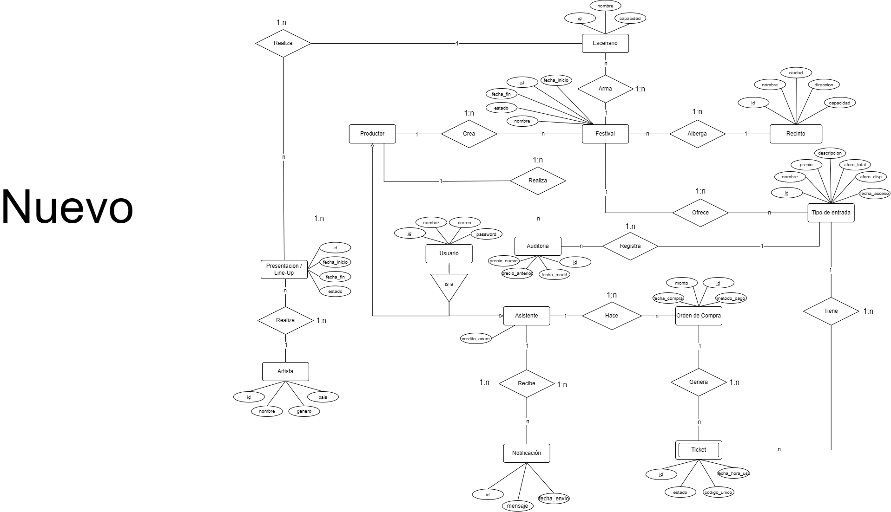

# Sistema de Gestión de Festivales de Música

**Laboratorio 1 - Grupo 3 - Ejecución**

Una plataforma para gestionar festivales, recintos, escenarios, artistas,
presentaciones (line-up), tipos de entrada, venta de tickets y control de acceso.

---
### Integrantes

- Felipe Aedo
- Diego Cabrera
- Fabian Herrera
- Matias Lagos
- Benjamin Ortega

---
### Tecnologías

- Backend: Express.js (Node.js)
- Frontend: React (Vite)
- Estilos: _Por definir: heroui o shadcn (tailwindcss)_
- BD: PostgreSQL

---
### To-Do

1. API: CRUD completo de todas las entidades del modelo.

2. API/JWT: El Productor crea festivales y arma el line-up; el asistente compra entradas y
   solo puede ver sus propios tickets.

3. Procedimiento Almacenado 1: Comprar entradas: validar el cupo disponible del tipo de
   entrada, crear la orden, generar un ticket con código único por cada entrada y descontar
   el aforo en una sola transacción atómica.

4. Procedimiento Almacenado 2: Cancelar una presentación: marcarla como cancelada,
   generar notificaciones para todos los asistentes con entradas para ese día y asignarles
   un crédito de compensación.

5. Trigger 1: Impedir programar una presentación que se superponga en horario con otra
   en el mismo escenario, o que un mismo artista tenga dos presentaciones simultáneas.

6. Trigger 2: Registrar en una tabla de auditoría cada modificación del precio de un tipo de
   entrada, indicando precio anterior, precio nuevo, usuario y fecha.

7. Vista Materializada: "Ventas y Ocupación por Festival y Tipo de Entrada", con
   recaudación total y porcentaje de aforo vendido, refrescada diariamente al cierre de
   ventas.

8. Índices: Indexar el código único del ticket (Hash) y el ID del festival para acelerar la
   validación de accesos y los reportes.

9. API: Endpoint para obtener la grilla de presentaciones de un día del festival agrupada por
   escenario.

10. API: Endpoint de control de acceso que reciba el código de un ticket, verifique su validez
    y lo marque como utilizado, impidiendo su reutilización.

---
### Estructura del proyecto

```text
laboratorio-1-grupo-3/
├── backend/                  # Proyecto Express.js (Node.js)
│   ├── src/
│   │   ├── config/
│   │   ├── controllers/
│   │   ├── interfaces/       
│   │   ├── middlewares/
│   │   ├── repositories/
│   │   ├── routes/
│   │   ├── services/
│   │   └── routes/
│   │   └── app.ts
│   │   └── server.ts
│   ├── Dockerfile
│   ├── package.json
│   ├── package-lock.json
│   └── tsconfig.json
│
├── frontend/                 # Proyecto React (Vite)
│   ├── src/
│   ├── package.json
│   └── Dockerfile
│
├── database/                 # Scripts SQL
│   └── create.sql            # Tablas
│   └── fill.sql              # Datos de prueba
│   └── triggers.sql          # Triggers
│   └── procedures.sql        # Procedures
│   └── views.sql             # Views
│
├── presentacion/             # Diapositivas
│   └── presentacion.pdf
│
├── docker-compose.yml
└── README.md                 # Manual de despliegue y documentación de la API
```

---
### Diagrama MER



---
### Documentación API

1. presentacion

| Método | Endpoint                  | Descripción                      |
|--------|---------------------------|----------------------------------|
| GET    | `/api/presentaciones`     | Listar todas las presentaciones  |
| GET    | `/api/presentaciones/:id` | Lista una presentacion por su id |
| POST   | `/api/presentaciones`     | Crear una presentacion           |
| PUT    | `/api/presentaciones/:id` | Modificar una presentacion       |
| DELETE | `/api/presentaciones/:id` | Eliminar una presentacion (BD)   |

2. tipo_entrada

| Método | Endpoint                 | Descripción                        |
|--------|--------------------------|------------------------------------|
| GET    | `/api/tipos-entrada`     | Listar todos los tipos de entradas |
| GET    | `/api/tipos-entrada/:id` | Lista un tipo de entrada por su id |
| POST   | `/api/tipos-entrada`     | Crear un tipo de entrada           |
| PUT    | `/api/tipos-entrada/:id` | Modificar un tipo de entrada       |
| DELETE | `/api/tipos-entrada/:id` | Eliminar un tipo de entrada (BD)   |

3. escenario

| Método | Endpoint              | Descripción                  |
|--------|-----------------------|------------------------------|
| GET    | `/api/escenarios`     | Listar todos los escenarios  |
| GET    | `/api/escenarios/:id` | Lista un escenario por su id |
| POST   | `/api/escenarios`     | Crear un escenario           |
| PUT    | `/api/escenarios/:id` | Modificar un escenario       |
| DELETE | `/api/escenarios/:id` | Eliminar un escenario (BD)   |

4. orden_compra

| Método | Endpoint                  | Descripción                         |
|--------|---------------------------|-------------------------------------|
| GET    | `/api/ordenes-compra`     | Listar todas las ordenes de compra  |
| GET    | `/api/ordenes-compra/:id` | Lista una orden de compra por su id |
| POST   | `/api/ordenes-compra`     | Crear una orden de compra           |
| PUT    | `/api/ordenes-compra/:id` | Modificar una orden de compra       |
| DELETE | `/api/ordenes-compra/:id` | Eliminar una orden de compra (BD)   |